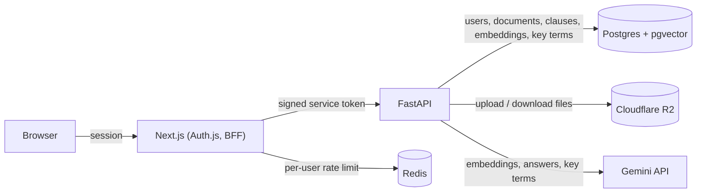

# Brief

Every clause, explained.

Brief reads a high stakes contract, an education loan, a lease, a job offer, and explains it in
plain English before you sign it. Ask it a question and it answers from the exact clause, with
the quote as proof. If the answer isn't in the document, it says so instead of guessing. It also
pulls out the terms that actually cost you money, and flagging anything unusual is next.

Status: in active development. [STATUS.md](STATUS.md) has the honest picture: what works today,
what is left, the numbers, and the expected finish. It is refreshed every week.

[docs/DEMO.md](docs/DEMO.md) is a script and screenshot list for recording a demo that claims no more than is true.

`scripts/check-all.sh` runs every check CI runs (add `--e2e` for the browser tests), stopping at the first failure.

[docs/ARCHITECTURE.md](docs/ARCHITECTURE.md) draws how it is put together: the parts, the data, the path of an upload, and
how an answer is reached and held back. To try it yourself, [docs/MANUAL-TEST.md](docs/MANUAL-TEST.md) is a step by step
checklist for the real sign in, the real API and the real model. [infra/DEPLOY.md](infra/DEPLOY.md) is the checklist for putting it online, and
[web/README.md](web/README.md) explains how to run and watch the browser tests.

## Why this exists

Education loans, leases and job offers are the contracts people sign with the least help and the most at stake, and
they are written to be skimmed, not read. Pasting one into a general chatbot gets a fluent answer with nothing to check
it against, and a confident answer to a question the document never answers.

Brief is built around the opposite rule: nothing is shown that cannot be proved from the document's own words. Every
answer carries the quote it came from, checked word for word. A question the document does not answer is said not to be
answered, and the important ones are listed with wording to ask the other side. Where Brief is unsure, it says so, and
what it has and has not been measured on is in [STATUS.md](STATUS.md).

## How an answer is checked

An answer is only shown if its evidence holds up.

1. Your question finds the most relevant clauses, using keyword and meaning-based search together.
2. The model is told to answer from those clauses only, and to quote the passage it relied on.
3. Brief checks that each quote really appears in the clause it names, word for word. A quote that
   does not is thrown away.
4. If nothing survives the check, you get "I couldn't find this in the document" and no guess.

The text of an uploaded contract is treated as text to read, never as instructions to follow. Key
terms such as the interest rate or the late fee go through the same checks, and every number in a
term must also appear in its quote.

A key term may rest on up to three quotes, each checked word for word against its own clause, because a
fact such as a deposit can be split across two sentences: the amount in one and the refund rule in the next.
Every number in the value must appear in one of the checked quotes, so a number from nowhere is still
rejected. The site shows one button per quote, and each jumps to its clause. A term saved with one quote
before this change still loads as before.

The key terms and the "Before you sign" questions are each read three times with fixed seeds and
kept by vote: a term or answer stays only if most of the reads found it. The same contract read twice
by a model can come out differently, and this makes the result steadier. The second check on the
questions judges each answer on its own, with two seeded looks and a third only if they disagree. When
it judged the answers together instead, its verdict on one depended on which others were in the group.
On one real 36 clause lease, four unseeded reads of the key terms changed four fields between runs and
four voted reads changed none, and six runs of the questions gave the same two answers every time,
including the $3,498 deposit. Steadier is not the same as more accurate, and this is one lease, so it is
a check and not a claim about contracts in general. The cost is time: a document now makes about ten
or more model calls, three for the key terms, three for the questions, and two or three for each
answer that is checked, so reading one can take from a few seconds to about a minute on the free tier.

Search and answers are measured, not assumed. The reports in [evals/](evals/) show the scores and
where they fall short.

## Architecture

The frontend is a Next.js app that handles Google sign-in and acts as a thin
backend-for-frontend, it never talks to Postgres or R2 directly. For each request it checks the
session, applies a per-user rate limit through Redis, then mints a short-lived signed token and
calls the FastAPI service. FastAPI owns everything else: user lookup, document storage in R2,
the ingestion pipeline (text extraction, or cleanup and OCR for photos and for the pages of a scanned PDF, then splitting into clauses
and embedding them), hybrid search, grounded answers, and key-term extraction, all backed by
Postgres.

## Security

Brief holds private documents, so each layer limits what it can reach. What is in place today:

- **Sign-in and tokens.** Google sign-in through Auth.js. The browser never calls the API. The web
  server checks the session, then mints a token signed with a shared secret that expires after 60
  seconds, and the API rejects any token that is unsigned, uses another algorithm, has no expiry, or has
  expired. The secret should be at least 32 random characters, and both the API and the website
  refuse to run in production with the built-in development secret or a shorter one. The API also
  refuses a blank secret anywhere, and the development database password in production.
- **Your documents are yours.** Every document request checks that it belongs to the caller, and
  someone else's document answers "not found", so its existence is not confirmed.
- **Uploads.** Files go straight to private storage with links that expire after five minutes. When an
  upload is confirmed, the real size and the first bytes are read from storage and checked against what
  the browser claimed. An empty or over-limit file, or one that is not the kind it says, is removed and
  refused. A second confirm for the same document is refused.
- **File names.** A name is trimmed and must be 1 to 200 characters with no control characters, the
  same rule for an upload as for a rename.
- **Limits.** 50 MB a file, 25 documents a person, 100 pages a document, and a per-user request limit
  of 30 a minute in Redis. Each person also has a daily limit on what calls the model, counted in
  Postgres with one atomic statement so simultaneous requests cannot slip past it: 100 questions, 30
  document reads (an upload, a retry or reading again) and 60 overviews. Reading an overview that was
  already saved is free, so reaching the limit never locks anyone out of their results. `GET /me/usage`
  reports where a person stands, and the chat box says how many questions are left once ten or fewer
  remain.
- **Abandoned uploads.** An upload that was started and never confirmed within an hour is removed, file
  first and then its record, when its owner starts the next upload, so it cannot sit as "Uploading" for
  ever or hold a slot against the document limit. Only a pending document is ever touched.
- **Deleting.** Deleting a document removes its file first and then its records, and deleting an
  account does the same for every document, one at a time, so a failure never leaves a record without
  its file or a file without a record. It can be repeated until it finishes.
- **Untrusted text.** The text of a contract is treated as data, never as instructions. The model has
  no tools to act with, and an answer is only shown if its quote is really in the document.
- **Web hardening.** Security headers on every response (no framing, no content sniffing, HTTPS only,
  no camera or microphone), and fonts come from packages, so no visitor's browser asks a third party
  for one. No other website can call the API from a browser, and a test checks that.
- **Logs.** Each model call is timed and logged as a fixed line such as `model call answer ok in 2.5s`,
  with a kind from a short fixed list, whether it worked, and how long it took, and nothing of what was
  sent or received, not even an error message. A log line may carry only a fixed message and ids. A test reads every logging call and fails
  if one could carry the text of a document, a question, an answer or a file name.
- **API documentation.** The API documents itself at `/docs` while running locally, with every route grouped,
  described and listing the errors it can give, checked by tests. Production does not serve it.
- **Following one request.** The website gives every call to the API a request id and the API puts the same
  id in every log line it writes while handling that call, shown as `[id]`, or `[-]` outside a request. Both
  hand the id back in an `X-Request-ID` header, so when something fails a person can quote the id and the
  whole path can be found in the logs. An id sent from outside is kept only if it is 8 to 64 letters, digits
  and dashes, so it cannot be used to forge a log line.
  When a question, an upload, a read, a retry, a rename or a delete of a document or of the account fails, the message ends with `Reference: 3f2b8c1e`,
  the first eight characters of that id. Searching the API log for `[3f2b8c1e` finds every line of that
  request. Nothing is shown when the server sent no id or one that does not look like an id.
  Every question also saves an answer trace: how it ended (`answered`, `not_found`, `withheld`,
  `nothing_to_search` or `failed`), how long it took, and the ids of the clauses the model was shown and the
  ones it cited. Run `python -m scripts.find_request 3f2b8c1e` from `api/` to print the trace for a reference
  code. A trace holds ids only, never the question, the answer or any text of a document, and a test fails
  if a column with a text-like name (question, answer, text, quote, filename, body or content) is added. Traces are removed after 30 days, when the person next starts an upload,
  and with their document or account. Failing to save a trace never turns an answer into an error.
- **Dependencies.** A scan of the libraries that ship runs on every push and every Monday, and the
  build fails on a known high severity problem.

What is not done yet, so nobody assumes it is:

- **It is not deployed.** Putting it online needs HTTPS everywhere and an API that only the web app can
  reach, because the request limit lives in the web layer.
- **The text of your documents goes to Google's Gemini.** On the free tier Google's terms allow using
  that content to improve its products, and I believe paid billing removes that, so check the current
  terms and turn billing on before real people upload real documents.
- **PDFs from strangers are parsed by a library.** Brief checks the file type and size first, but a
  malicious PDF is still a risk worth reducing, for example by reading it in an isolated process.
- **No audit trail and no retention rule.** Nothing records who opened what, and documents are kept
  until their owner deletes them.
- **Encryption at rest** depends on the hosts. Confirm it for the database when it is deployed.
- **Build and lint tools** have one known high severity report left (October 15): `braces`, used by the
  linter and the shadcn command line tool, can be made to use a lot of memory by a deeply nested pattern. No
  fixed version exists yet (3.0.3 is the newest). It is not part of what ships, nobody outside the project can
  hand it a pattern, and the scan above covers only what does ship, which has no known problems.

## Limits and what a failed read says

Every page costs a reading call on a metered service, so there are limits: 50 MB a file, 25
documents a person (delete one to make room), and 100 pages a document. A refused file is turned away
before any page is read.

When a read fails, the document says why and what to do about it: no text found, a file that cannot
be opened (damaged or password protected), too many pages, a file that could not be fetched, the
reading service being busy, or the day's reading limit being reached. While a long document is being
read, its row shows how many parts are done so far.

## Running locally

You will need Docker, Python 3.12, Node 22 with pnpm, and Tesseract for reading photos and scanned pages
(`brew install tesseract` on a Mac, `sudo apt-get install tesseract-ocr` on Ubuntu).

Start the shared services:

    docker compose up -d

This starts Postgres, with pgvector, and Redis.

Backend (from `api/`):

    python3.12 -m venv .venv
    source .venv/bin/activate
    pip install -r requirements-dev.txt
    alembic upgrade head
    uvicorn app.main:app --reload

Copy `api/.env.example` to `api/.env` first and fill in the real values (R2 credentials,
a Gemini API key, a JWT secret). The API refuses to start with a blank JWT secret, and with `ENVIRONMENT=production` it also
refuses the built-in development secret, a secret under 32 characters, and the development database
password.

Run the backend test suite (from `api/`, with the venv active and Postgres running):

    python -m pytest

Frontend (from `web/`): create `web/.env.local` with these variables, then start it.

    AUTH_SECRET=         # any long random string, for example from: openssl rand -base64 32
    AUTH_GOOGLE_ID=      # Google OAuth client ID
    AUTH_GOOGLE_SECRET=  # Google OAuth client secret
    SERVICE_JWT_SECRET=  # must match SERVICE_JWT_SECRET in api/.env
    BACKEND_URL=http://localhost:8000
    REDIS_URL=redis://localhost:6379

The Google OAuth client needs `http://localhost:3000/api/auth/callback/google` as an authorized
redirect URI.

    pnpm install
    pnpm dev

Frontend checks: `pnpm lint`, `pnpm test`, `pnpm build`, and `pnpm e2e` (browser tests of the signed out pages).

Once after cloning, install the commit hook, which refuses a commit message that credits an AI tool
(`scripts/check-commit-messages.sh` checks the whole history, and CI runs it too):

    scripts/install-hooks.sh

The evaluations call the real Gemini API and need Postgres running. Each one is a single command,
see [evals/README.md](evals/README.md).

## Running it in containers

Both parts have a Dockerfile. Neither image contains a secret, every setting comes from the environment,
and both run as a non-root user.

    docker build -t brief-api api
    docker build -t brief-web web

The API listens on `$PORT` (8000 if unset). `/health` only says the process is up, so use it to decide
whether to restart the container. `/health/ready` answers 200 only when the database responds and is on the
migration this code expects, and 503 otherwise, so use it to decide whether to send traffic. Its answer
never includes an error message. It needs the settings in
`api/.env.example`. With `ENVIRONMENT=production` it refuses to start on the built-in secret, a secret
under 32 characters, or the development database password. The database schema is a separate step, run
once for each release:

    docker run --rm --env-file api/.env brief-api alembic upgrade head

The website listens on `$PORT` (3000 if unset). It needs `AUTH_SECRET`, `AUTH_GOOGLE_ID`,
`AUTH_GOOGLE_SECRET`, `SERVICE_JWT_SECRET` (the same value the API has), `BACKEND_URL` and `REDIS_URL`.
Outside Vercel, Auth.js also needs `AUTH_TRUST_HOST=true`, and without it the sign in routes answer 500.

I built both images and ran them: the API refused weak production settings and started with good ones,
and the website served the landing page with its security headers and turned away anonymous requests.
The API image is about 1 GB, mostly OpenCV and the reranker, and the website image about 400 MB. Nothing
is deployed anywhere yet.

## License

MIT
