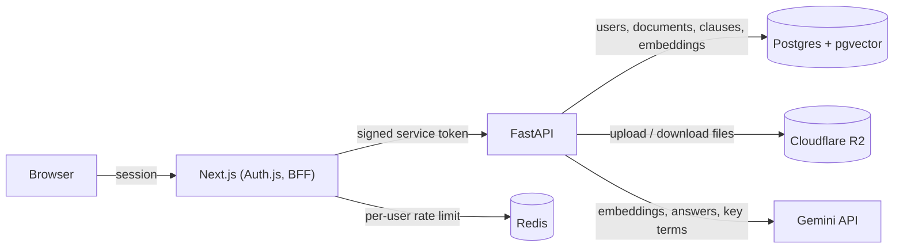

# Brief

Every clause, explained.

**Live at [briefcontracts.com](https://briefcontracts.com).**

Brief reads a loan, a lease or a job offer and explains it in plain English before you sign. Ask it a question
and it answers from the exact clause, with the quote as proof. If the document doesn't say, it tells you that
instead of guessing. It also pulls out the terms that cost you money and the questions people usually forget to ask.

I built it because these are the contracts people sign with the least help and the most at stake. They are written
to be skimmed, not read, and a general chatbot will give you a fluent answer with nothing to check it against.
Brief is built around the opposite rule: nothing is shown that can't be proved from the document's own words.

[STATUS.md](STATUS.md) is the honest picture: what works, what doesn't, the numbers, and what I'm unsure about.

## What it does

- **Reads what you give it.** PDFs, scanned PDFs (by OCR), and photos of paper pages (JPG, PNG, HEIC), including
  from a phone camera. Up to five photos make one document with a page for each. A blurry photo is refused with a reason
  instead of quietly accepted.
- **Key terms.** The interest rate, fees, deposit, dates and so on, each with its quote. Click one and the
  clause opens with the exact words highlighted.
- **Before you sign.** The questions people most often skip, answered from the document or marked as not covered,
  with wording you can send to the other side.
- **Ask.** Ask in your own words and get an answer that points to the clause it came from.
- **Take it with you.** Copy the summary, download it as a PDF, add the dates to a calendar, email the open
  questions, or print it.
- **Dashboard and documents.** Where your documents stand, the soonest dates, folders, search, rename, read again,
  and a Bin that keeps deleted documents for 7 days.
- **Sharing.** Show your dashboard to someone you approve, for a time you pick (1 hour up to 90 days), and take it
  back whenever you like.
- **Account.** Google sign-in, optional two-step verification, daily limits shown plainly, and deleting your
  account removes everything.
- **A short tour** for first-time visitors, which can be replayed from Profile.

It works on a phone and on a laptop, in light and dark.

## How an answer is checked

An answer is only shown if its evidence holds up.

1. Your question finds the most relevant clauses, using keyword and meaning-based search together.
2. The model is told to answer from those clauses only, and to quote the passage it relied on.
3. Brief checks that each quote really appears in the clause it names, word for word. A quote that doesn't is
   thrown away.
4. If nothing survives, you are told the document doesn't seem to cover it.

The text of a contract is treated as text to read, never as instructions to follow. Every number in a key term
must also appear in its quote. The key terms and the "Before you sign" questions are each read three times with
fixed seeds and kept by vote, because the same contract read twice by a model can come out differently. Steadier is
not the same as more accurate, and the scores are in [STATUS.md](STATUS.md) with their caveats.

## How it's built

The website is a Next.js app that handles Google sign-in and acts as a thin backend for the browser. It never
touches the database or storage. For each request it checks the session, applies a per-user rate limit through
Redis, mints a token that expires after 60 seconds, and calls the FastAPI service, which owns everything else:
storage, reading documents (text, or OCR for photos and scans), splitting them into clauses, search, answers and
key terms.

Hosting: the website on Vercel, the API on Render, the database on Neon, Redis on Upstash, files on Cloudflare R2.
[docs/ARCHITECTURE.md](docs/ARCHITECTURE.md) draws the parts, the data and the path of an upload.

## Limits

Every page read costs a call on a metered service, so there are limits: 50 MB a file, 25 documents a person, 100
pages a document. Each person also has a daily allowance: 40 questions, 10 document reads and 20 overviews
(opening a saved overview is free). The whole site has a daily cap on model calls as the real spending guard.
A failed read says why and what to do about it.

## Security and privacy

Brief holds private documents, so each layer limits what it can reach.

- **Sign-in.** The browser never calls the API. The website checks the session and signs a short-lived token. The
  API refuses tokens that are unsigned, expired, or signed with a weak or default secret, and refuses to start in
  production with weak settings.
- **Your documents are yours.** Every request checks ownership, and someone else's document answers "not found".
- **Uploads.** Files go straight to private storage with links that expire after five minutes. Size and file type
  are checked against what is really stored, and a file that isn't what it claims is removed.
- **Deleting.** Deleting a document removes its file and its records, and deleting an account does the same for
  everything.
- **Logs.** A log line carries a fixed message and ids, never the text of a document, a question or an answer. A
  test reads every logging call and fails if one could.
- **Admin.** The owner's page shows totals only: people, sign-ins, documents, questions and average time in Brief.
  It cannot show a document or a question.
- **Dependencies.** A scan of the libraries that ship runs on every push and every week, and the build fails on a
  known high severity problem.

What is not covered, so nobody assumes it is:

- The text of your documents goes to Google's Gemini. Brief uses the paid API, but check Google's current terms
  for how content is handled before you upload something sensitive.
- PDFs from strangers are parsed by a library. Brief checks type and size first, but reading them in an isolated
  process would reduce the risk further.
- There is no audit trail of who opened what, and documents are kept until their owner deletes them.
- It is not legal advice. It explains what a document says.

## Run it locally

You need Docker, Python 3.12, Node 22 with pnpm, and Tesseract for photos and scanned pages (`brew install tesseract`
on a Mac, `sudo apt-get install tesseract-ocr` on Ubuntu).

    docker compose up -d        # Postgres with pgvector, and Redis

Backend, from `api/`. Copy `api/.env.example` to `api/.env` and fill in the real values first (R2, a Gemini key, a
JWT secret).

    python3.12 -m venv .venv
    source .venv/bin/activate
    pip install -r requirements-dev.txt
    alembic upgrade head
    uvicorn app.main:app --reload

Frontend, from `web/`. Create `web/.env.local`:

    AUTH_SECRET=         # a long random string, for example from: openssl rand -base64 32
    AUTH_GOOGLE_ID=      # Google OAuth client ID
    AUTH_GOOGLE_SECRET=  # Google OAuth client secret
    SERVICE_JWT_SECRET=  # must match SERVICE_JWT_SECRET in api/.env
    BACKEND_URL=http://localhost:8000
    REDIS_URL=redis://localhost:6379

The Google client needs `http://localhost:3000/api/auth/callback/google` as a redirect address.

    pnpm install
    pnpm dev

## Tests

    python -m pytest          # from api/, with the venv active and Postgres running
    pnpm test                 # from web/, unit tests
    pnpm e2e                  # from web/, browser tests
    scripts/check-all.sh      # everything CI runs (add --e2e for the browser tests)

The browser tests run against a fake API that checks tokens the way the real one does, so they show that the website
behaves correctly given those answers. They include accessibility scans and phone-width checks.
[web/README.md](web/README.md) explains how to run and watch them. The evaluations call the real Gemini API; see
[evals/README.md](evals/README.md).

Changes go in through short branches and pull requests ([CONTRIBUTING.md](CONTRIBUTING.md)). After cloning, run
`scripts/install-hooks.sh` once to install the commit hook.

## Putting it online

Both parts have a Dockerfile, no image contains a secret, and both run as a non-root user. The API's `/health/ready`
answers 200 only when the database responds and is on the migration the code expects, and the database schema is a
separate step for each release (`alembic upgrade head`). [infra/DEPLOY.md](infra/DEPLOY.md) is the checklist and lists
every setting. [docs/MANUAL-TEST.md](docs/MANUAL-TEST.md) is a step by step check of the real sign-in, the real API
and the real model.

## License

MIT
