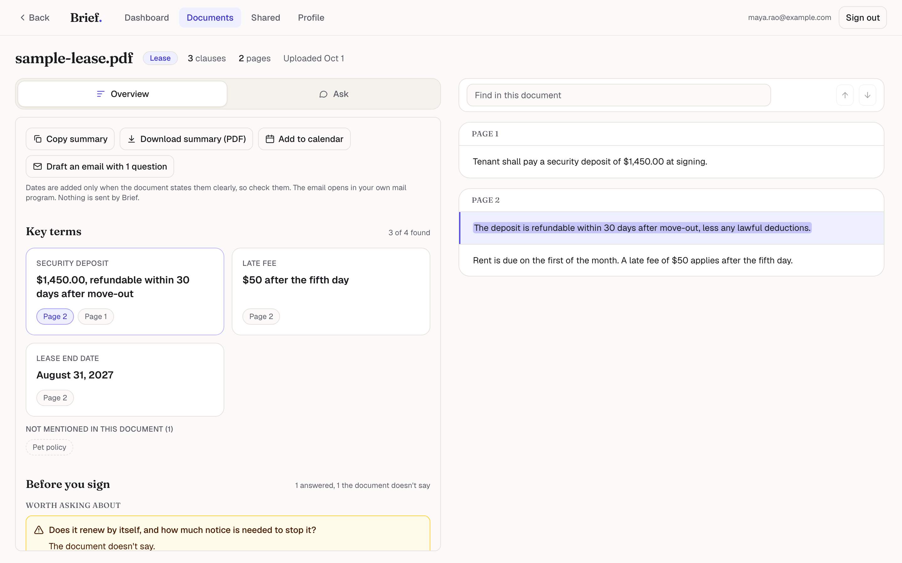

# Brief

**Every clause, explained.**

Brief reads a loan, a lease or a job offer and explains it in plain English before you sign. Every answer comes with the exact quote it rests on, and when the document does not cover a question, Brief says so instead of guessing. It is built for people who sign these contracts with very little help: tenants, borrowers and new hires.

Under the hood it is a retrieval-augmented pipeline where code, not the model, decides what is shown: a quote that cannot be found word for word in the document is thrown away.

Live at **[briefcontracts.com](https://briefcontracts.com)**

<p align="center">
<a href="https://nextjs.org"></a>  <a href="https://www.typescriptlang.org"></a>  <a href="https://fastapi.tiangolo.com"></a>  <a href="https://www.python.org"></a><br>
<a href="https://www.postgresql.org"></a>  <a href="https://ai.google.dev"></a>  <a href="https://github.com/iamshrey10/Brief/actions/workflows/ci.yml"></a>
</p>

## Overview

You upload a PDF, a scan, or up to five phone photos of a contract. Brief splits it into numbered clauses, pulls out the terms that cost you money (interest rate, fees, deposit, notice period), lists the questions people usually forget to ask, and lets you ask your own questions. Each answer points to the clause it came from, with the quoted words highlighted.

[STATUS.md](STATUS.md) is the honest account of what works, what does not, and what I am unsure about.

## The problem and the solution

Contracts are written to be skimmed, not read. The clauses that matter most, such as late fees, early termination, automatic renewal and who pays for what, are easy to miss, and most people have nobody to ask. A general chatbot can explain them fluently, but it gives you nothing to check the answer against, and a confident wrong answer about a contract is worse than none.

Brief is built around one rule: nothing is shown that cannot be proved from the document's own text. Answers are tied to the clause they came from, and if the document does not say, the answer is "this document does not seem to cover that." It explains what a document says. It is not legal advice.

## Key features

- **Key terms with proof.** The main facts of a document, each with its quote. Click one and the clause opens with the exact words highlighted.
- **Before you sign.** The questions people most often skip, answered from the document or marked as not covered, with wording you can send to the other side.
- **Ask in your own words.** Every answer cites its clause. If nothing in the document supports an answer, you are told so.
- **Any document, any format.** PDFs, scanned PDFs (OCR) and phone photos, with hard-to-read pages flagged instead of silently accepted.
- **Take it with you.** Copy the summary, download it as a PDF, add dates to a calendar, or email the open questions.
- **Dashboard.** Every document, the soonest dates and the questions still open, without calling the model.
- **Sharing.** Show your dashboard to someone you approve, for a time you choose (1 hour to 90 days), and revoke it at any time.
- **Account security.** Google sign-in, optional two-step verification with an authenticator app, and deleting your account removes everything.

## Application preview

**Key terms.** Each key term shows its quote, and clicking it opens the clause with the exact words highlighted.



**Asking a question.** The answer cites the clause it came from, with the quote that supports it.


**Dashboard.** Every document, the soonest dates and the questions still open.


On a phone:

 

It works on a phone and a laptop, in light and dark. More screens are in [Brief-Resources/02-Application-Screenshots](Brief-Resources/02-Application-Screenshots/Web).

## Technology stack

| Area | Technologies | What they do in Brief |
|---|---|---|
| **Frontend** | Next.js 16 (App Router), React 19, TypeScript, Tailwind CSS 4, shadcn/ui, Auth.js | Renders every screen and handles Google sign-in. It is also the browser's only door to the API: its `/api/backend/*` routes check the session, apply a per-user rate limit, and sign a 60-second token for each call. |
| **Backend** | FastAPI, Python 3.12, SQLAlchemy 2 (async), Alembic, Pydantic | Owns everything that matters: reading documents, splitting clauses, search, answers, key terms, daily limits, sharing and two-step verification. 49 route handlers. |
| **Database and storage** | PostgreSQL 16 with pgvector, Redis 7, Cloudflare R2 | Postgres holds users, documents, clauses, their embeddings and a full-text index, so one query can use meaning and keywords. Redis holds the rate-limit counters. R2 holds the uploaded files, reached only through links that expire after five minutes. |
| **AI and LLM** | Google Gemini (`gemini-3.5-flash-lite`, `gemini-embedding-001`), PyMuPDF, Tesseract OCR, OpenCV | Embeddings and search find the right clauses. The model writes answers, key terms and questions, and a second call judges them. PyMuPDF reads PDF text, and Tesseract reads scans and photos. |
| **Infrastructure and DevOps** | Docker, Vercel, Render, Neon, Upstash, GitHub Actions, Dependabot | The website runs on Vercel and the API in a container on Render, with managed Postgres and Redis. GitHub Actions runs the checks on every change and a dependency audit every week. |
| **Testing and tools** | pytest, Vitest, Testing Library, Playwright with axe-core, ESLint, Ruff, pnpm | Unit, integration and browser tests, including accessibility scans and phone-width checks. |

## How it works

1. **Sign in.** Google sign-in through Auth.js. The website issues a short-lived signed token for each call to the API.
2. **Upload.** The browser sends the file straight to private storage. The API then checks the real size and type of the file that arrived before it accepts it.
3. **Read.** The API extracts the text (OCR for scans and photos), splits it into numbered clauses, turns each clause into an embedding, and stores everything in Postgres.
4. **Overview.** Key terms and questions are built once: the model reads the document three times, code checks each result against the text, the three reads are voted, and a separate judge call reviews the answers. The result is saved, so opening it again is free.
5. **Ask.** The question is searched against the clauses by keywords and by meaning. The model answers from the top clauses and quotes its evidence, and code checks every quote before anything is shown.
6. **Take it away.** Copy or download the summary, add dates to a calendar, or share the dashboard.

## System architecture


- The **browser** only talks to the **website**, which verifies the session and rate limit and forwards the request with a signed 60-second token.
- The **API** is the only part with database access and the only one that calls the model, so the rules live in one place. It also issues the short-lived links the browser uses to send files straight to storage.
- **Postgres** stores the documents and their embeddings, **R2** stores the files, **Redis** stores short counters, and **Gemini** is called only from the API.

Details: [docs/ARCHITECTURE.md](docs/ARCHITECTURE.md), [System Architecture (PDF)](Brief-Resources/06-System-Architecture/Brief-System-Architecture.pdf) and [System Design (PDF)](Brief-Resources/07-System-Design/Brief-System-Design.pdf).

## AI and LLM integration

Gemini is used in three places, always from the API and never from the browser. Everything around those calls is ordinary code.

| Where | Model | Purpose |
|---|---|---|
| Reading a document | `gemini-embedding-001` | Turns each clause into 768 numbers that capture its meaning |
| Asking a question | `gemini-embedding-001`, `gemini-3.5-flash-lite` | Finds the best clauses, then writes one answer with quotes |
| Key terms and questions | `gemini-3.5-flash-lite` | Reads the document three times, then a separate call judges each answer |

**How an answer is grounded.** The question is searched against the document's clauses by keywords (Postgres full-text) and by meaning (pgvector), and the results are merged by rank. The top eight clauses go to the model with an instruction to answer only from them and to quote the passage it used. Document text is treated as text to read, never as instructions to follow.

**How unsupported answers are handled.** Code checks that each quote appears word for word in the clause it names. A quote that does not is dropped. If no quote survives, Brief tells you the document does not seem to cover the question rather than showing an answer. In key terms, every number must also appear in its quote.

**Steadier results.** Key terms and questions are read three times with fixed seeds and temperature 0, and a result is kept only if more than half of the reads agree.

**Honest limits.**
- The checks prove a quote exists in the document. They do not prove the model understood it correctly.
- Evaluation sets are small (24 search questions, 135 answer questions on three short documents), so scores such as the 96 percent right-clause-first result are encouraging, not a general claim.
- A reranking step I tried scored worse (67 percent against 96), so it is switched off.
- The text of your document is sent to Google's Gemini API. Check Google's current terms before uploading something sensitive.
- There is no tool calling, no agent loop and no fine-tuning.

More: [AI and LLM documentation (PDF)](Brief-Resources/05-Technology-Stack/Brief-AI-LLM-Documentation.pdf) and [evals/README.md](evals/README.md).

## Engineering and technical decisions

- **The browser never calls the API.** One door in the website checks the session and rate limit and signs a 60-second token. The API refuses unsigned, expired or weakly signed tokens, and refuses to start in production with weak secrets.
- **Code verifies the model.** Quote checking, number checking and voting are plain code with tests, so a wrong answer has to get past deterministic checks, not just a prompt.
- **Hybrid search over a single method.** On my recorded test, keyword search alone found the right clause first 4 percent of the time and the hybrid search 96 percent. Both searches live in Postgres, so there is no separate vector database to run.
- **Uploads go straight to private storage.** Files never pass through the API. The API checks the real size and type afterwards and removes a file that is not what it claims.
- **Cost and abuse limits.** Each person has daily limits (40 questions, 10 document reads, 20 overviews), and the whole site has a daily cap on model calls as the real spending guard.
- **Privacy by design.** Logs carry fixed messages and ids, never document text, and a test reads every logging call to enforce it. Deleting an account removes every file and record; a deleted document waits in a 7-day Bin first.
- **Failure is visible.** A failed read says why in plain words and ends with a short reference code that finds the matching log lines.

Longer write-ups: [System Design (PDF)](Brief-Resources/07-System-Design/Brief-System-Design.pdf), [Technology Stack (PDF)](Brief-Resources/05-Technology-Stack/Brief-Technology-Stack.pdf), [CI/CD (PDF)](Brief-Resources/08-CI-CD/Brief-CI-CD-Explanation.pdf) and [docs/PRIVACY-REVIEW.md](docs/PRIVACY-REVIEW.md).

## Testing and quality

Measured on November 17, 2026 on a laptop:

| Suite | Total | Passed | Failed | Skipped |
|---|---|---|---|---|
| API (pytest) | 1,298 | 1,298 | 0 | 0 |
| Website unit tests (Vitest) | 1,937 | 1,937 | 0 | 0 |
| Browser tests (Playwright, Chromium) | 342 | 342 | 0 | 0 |
| **All** | **3,577** | **3,577** | **0** | **0** |

ESLint, TypeScript, Ruff and the production build are clean.

- **Continuous integration.** Every push and pull request runs three required jobs on GitHub Actions: website lint, tests and build; browser tests; and API lint and tests. Coverage floors are enforced in both test suites, and a check fails the build if a recorded AI evaluation score drops.
- **Dependency audit.** `pnpm audit` and `pip-audit` run on every push and every week.
- **Browser tests use a fake API.** They show the website behaves correctly given the API's answers, not that the real API is correct. They include accessibility scans.
- **AI evaluations** call the real Gemini API, so they run on demand with a key and are not part of the automated suite. Their recorded scores and caveats are in [STATUS.md](STATUS.md).

## Running Brief locally

**Prerequisites:** Docker, Python 3.12, Node 22 with pnpm, and Tesseract for photos and scans (`brew install tesseract` on macOS, `sudo apt-get install tesseract-ocr` on Ubuntu). Real use also needs a Gemini API key, a Cloudflare R2 bucket and a Google OAuth client.

```bash
git clone https://github.com/iamshrey10/Brief.git
cd Brief
docker compose up -d          # Postgres with pgvector, and Redis
```

**API**, from `api/`. Copy `api/.env.example` to `api/.env` and fill in `SERVICE_JWT_SECRET`, `GEMINI_API_KEY` and the `R2_*` values.

```bash
python3.12 -m venv .venv
source .venv/bin/activate
pip install -r requirements-dev.txt
alembic upgrade head
uvicorn app.main:app --reload
```

**Website**, from `web/`. Copy `web/.env.example` to `web/.env.local` and fill it in: `AUTH_SECRET`, `AUTH_GOOGLE_ID`, `AUTH_GOOGLE_SECRET`, `SERVICE_JWT_SECRET` (the same value as the API's), `BACKEND_URL=http://localhost:8000` and `REDIS_URL=redis://localhost:6379`. The Google client needs `http://localhost:3000/api/auth/callback/google` as a redirect address.

```bash
pnpm install
pnpm dev
```

**Tests**

```bash
python -m pytest              # from api/, venv active, Postgres running
pnpm test                     # from web/, unit tests
pnpm e2e                      # from web/, browser tests
scripts/check-all.sh          # everything CI runs (add --e2e for the browser tests)
```

The tests run on placeholder values and fakes, so they need no real Gemini, R2 or Google credentials (CI runs them that way); the API tests do need Postgres running. [infra/DEPLOY.md](infra/DEPLOY.md) lists every setting for a deployment, and [docs/MANUAL-TEST.md](docs/MANUAL-TEST.md) walks through checking the real sign-in, API and model.

## Project structure

```text
api/          FastAPI service: routes, reading, retrieval, answering, checks, limits, sharing
  migrations/   Alembic database migrations
  tests/        pytest suite
web/          Next.js website: pages, components, helpers, Playwright tests in e2e/
evals/        Evaluations that call the real model, with recorded results
docs/         Architecture, privacy review, manual test and implementation notes
docs-source/  Sources that build the PDFs and diagrams
Brief-Resources/  Screenshots, PDFs and diagrams
infra/        Deployment checklist
scripts/      Check-all, commit message check, hook installer
```

## Future improvements

These are ideas, not features that exist today.

- Word (.docx) files, and several files in one upload.
- Better handling of low-quality photos.
- Larger and messier evaluation sets, including exact-term questions.
- Reading PDFs from strangers in an isolated process, and an audit trail of who opened what.
- Updating the development-tool dependencies behind the open alerts (none ship to users).

## Development and acknowledgements

I built Brief with Claude Code as an AI development assistant, and I see working well with AI coding tools as part of how I build software today. The thinking was mine: the product idea, the feature requirements, the architecture and the trade-offs behind it, reviewing what was produced, debugging, and validating the result. The test suites and AI evaluations in this repository are how I check that the work does what I say it does.

The Privacy and Terms pages are plain language I wrote and have not been reviewed by a lawyer.

Author: [Shreyas Revankar](https://github.com/iamshrey10). There are no other contributors.

## License

[MIT](LICENSE)
