<div align="center">

# Brief

### Every clause, explained.

An AI contract reader that shows the exact words behind every answer, and says so when the document does not cover a question.

**[Live site: briefcontracts.com](https://briefcontracts.com)**

[](https://github.com/iamshrey10/Brief/actions/workflows/ci.yml)
[](https://github.com/iamshrey10/Brief/actions/workflows/audit.yml)


</div>

## Contents

1. [Overview](#overview)
2. [Problem and solution](#problem-and-solution)
3. [Key features](#key-features)
4. [Screenshots](#screenshots)
5. [Demo video](#demo-video)
6. [Technology stack](#technology-stack)
7. [Architecture](#architecture)
8. [AI and LLM integration](#ai-and-llm-integration)
9. [System design and data flow](#system-design-and-data-flow)
10. [API](#api)
11. [CI/CD](#cicd)
12. [Run it locally](#run-it-locally)
13. [Testing and verified results](#testing-and-verified-results)
14. [Project structure](#project-structure)
15. [Technical challenges and engineering decisions](#technical-challenges-and-engineering-decisions)
16. [Limits, security and privacy](#limits-security-and-privacy)
17. [Future improvements](#future-improvements)
18. [Documentation](#documentation)
19. [Contributors and license](#contributors-and-license)

## Overview

Brief reads a loan, a lease or a job offer and explains it in plain English before you sign. Ask it a question and it answers from the exact clause, with the quote as proof. If the document does not say, it tells you that instead of guessing. It also pulls out the terms that cost you money and the questions people usually forget to ask.

[STATUS.md](STATUS.md) is the honest picture: what works, what does not, the numbers, and what I am unsure about.

## Problem and solution

**The problem.** Leases, loans and job offers are the contracts people sign with the least help and the most at stake. They are written to be skimmed, not read, and a general chatbot will give a fluent answer with nothing to check it against. A guess in a contract is a risk you cannot see.

**The solution.** Brief is built around one rule: nothing is shown that cannot be proved from the document's own words. An answer appears only if the quote it rests on is found, word for word, in the clause it names. If nothing survives that check, Brief says the document does not seem to cover the question.

## Key features

- **Reads what you give it.** PDFs, scanned PDFs (by OCR), and photos of paper pages (JPG, PNG, HEIC), including from a phone camera. Up to five photos make one document. A photo or scan that is hard to read is flagged, and a file with no readable text is refused with a reason.
- **Key terms.** The interest rate, fees, deposit, dates and so on, each with its quote. Click one and the clause opens with the exact words highlighted.
- **Before you sign.** The questions people most often skip, answered from the document or marked as not covered, with wording you can send to the other side.
- **Ask.** Ask in your own words and get an answer that points to the clause it came from.
- **Take it with you.** Copy the summary, download it as a PDF, add dates to a calendar, email the open questions, or print it.
- **Dashboard and documents.** Where your documents stand, the soonest dates, folders, search, rename, read again, and a Bin that keeps deleted documents for 7 days.
- **Sharing.** Show your dashboard to someone you approve, for a time you pick (1 hour up to 90 days), and take it back whenever you like.
- **Account and security.** Google sign-in, optional two-step verification, daily limits shown plainly, and deleting your account removes everything.
- **A short tour** for first-time visitors, replayable from Profile. It works on a phone and a laptop, in light and dark.

## Screenshots

Real screens from the running application (more in [Brief-Resources/02-Application-Screenshots](Brief-Resources/02-Application-Screenshots/Web)).

| Dashboard | Key terms with quotes |
|---|---|
| 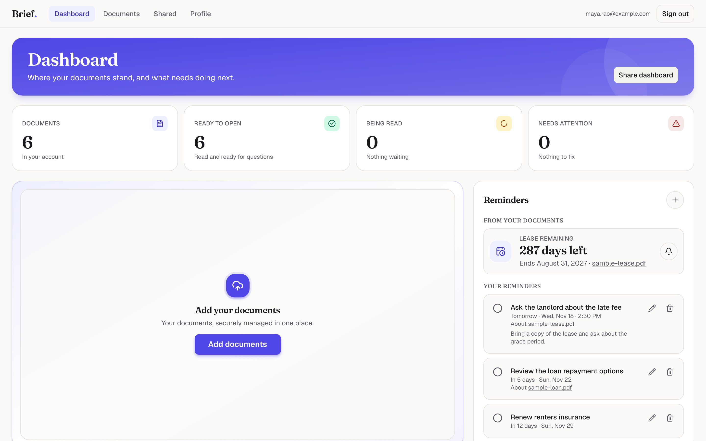 | 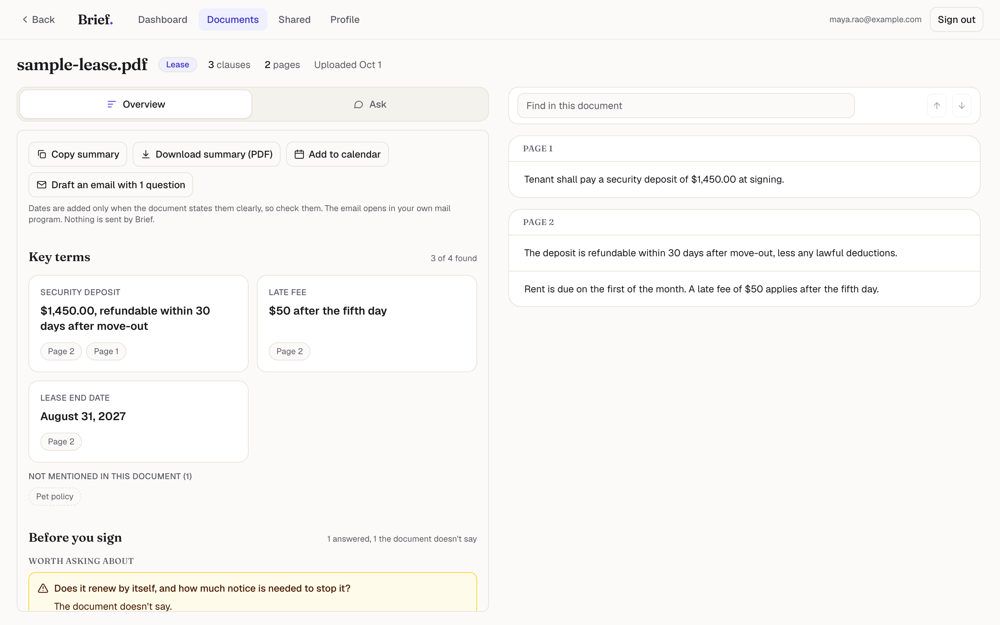 |
| **Before you sign** | **Ask, with the source quote** |
| 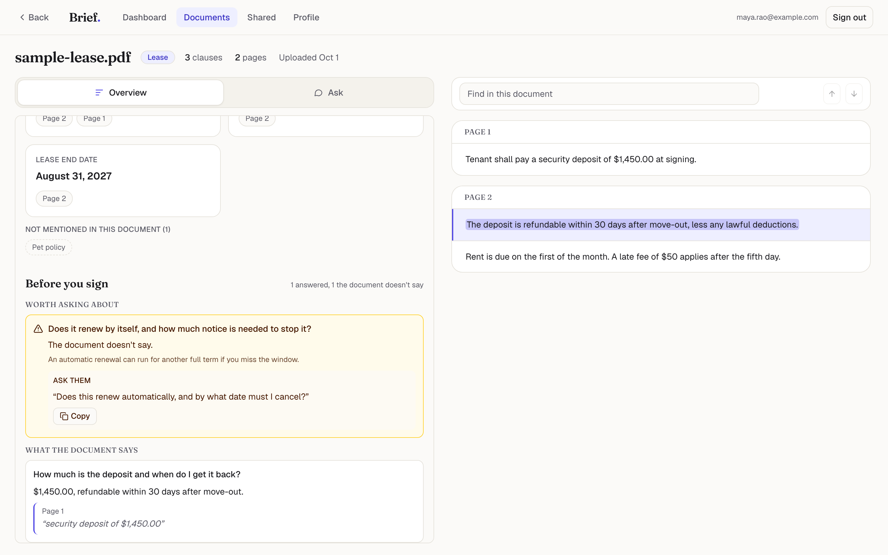 | 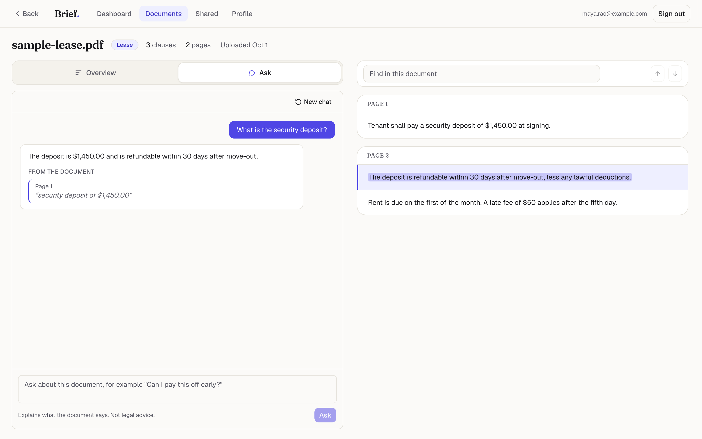 |

On a phone:

<p>
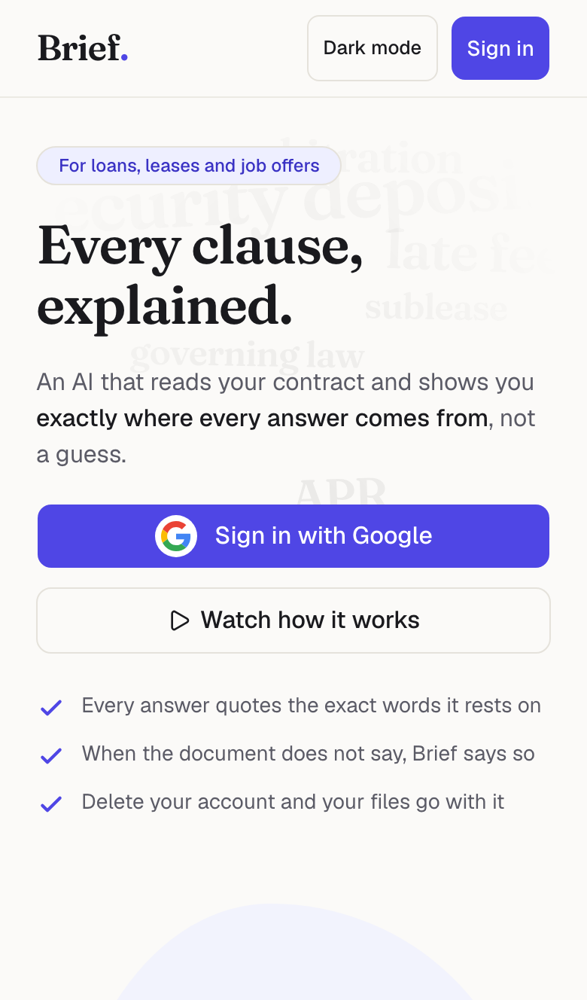
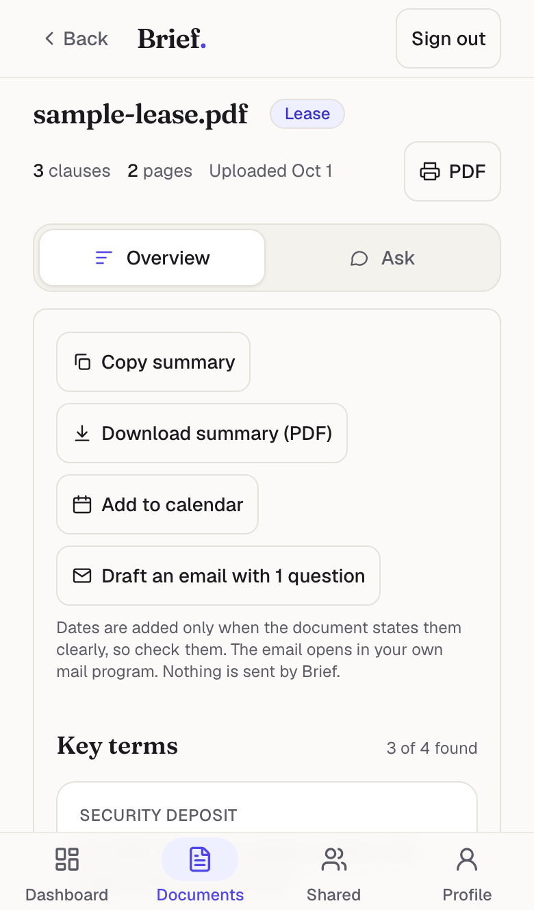
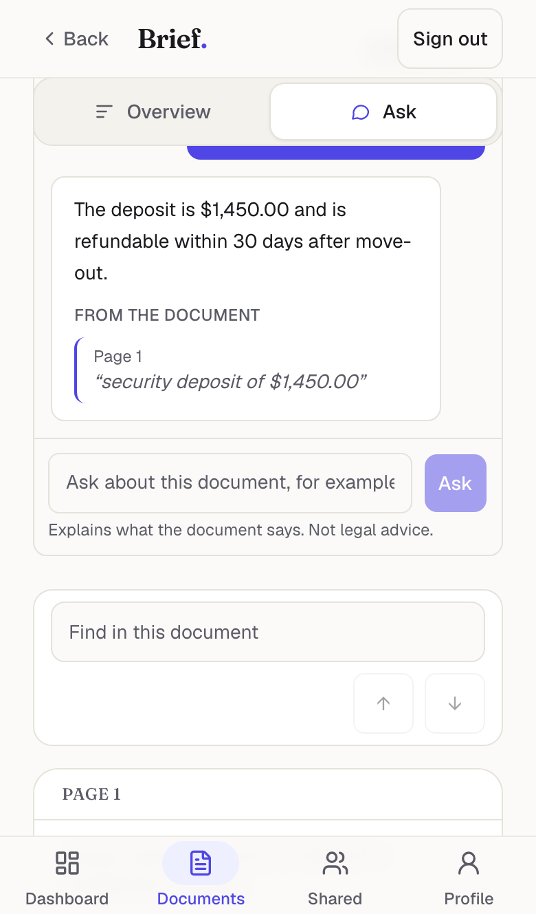
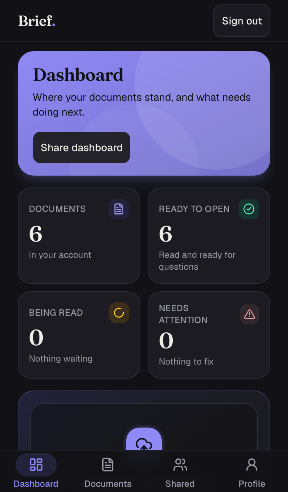
</p>

## Demo video

A 1 minute 29 second walkthrough made from the real application, the real API and real Gemini calls on the sample lease: the problem, the dashboard, adding any kind of document, key terms, questions to ask, asking with a checked source, sharing, two-step verification, and the technology. Every sentence is captioned.

[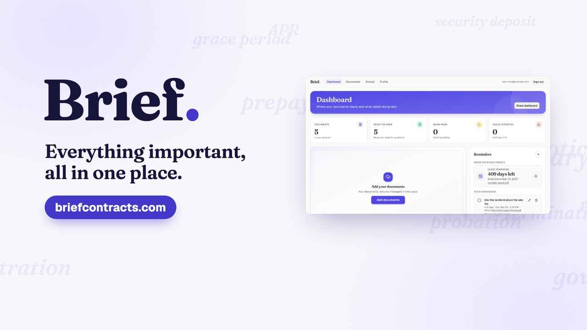](web/public/demo/brief-demo.mp4)

[Watch the video](web/public/demo/brief-demo.mp4), or press "Watch how it works" on [briefcontracts.com](https://briefcontracts.com). What is and is not shown as it really happens is written down in [docs/DEMO.md](docs/DEMO.md).

## Technology stack

| Layer | Technology |
|---|---|
| Website | Next.js 16, React 19, TypeScript, Tailwind CSS 4, shadcn/ui, Auth.js (Google sign-in) |
| API | FastAPI, Python 3.12, SQLAlchemy 2 (async), Alembic, Pydantic |
| Database | PostgreSQL 16 with pgvector, Redis 7 |
| AI | Google Gemini: `gemini-3.5-flash-lite` (answers, key terms, judging), `gemini-embedding-001` (768 numbers per clause) |
| Reading documents | PyMuPDF for text, Tesseract for scans and photos |
| Files | Cloudflare R2 (private, short-lived links) |
| Hosting | Vercel (website), Render (API), Neon (Postgres), Upstash (Redis) |
| Quality | pytest, Vitest, Playwright, ESLint, Ruff, GitHub Actions |

[Brief-Technology-Stack.pdf](Brief-Resources/05-Technology-Stack/Brief-Technology-Stack.pdf) explains what each is, why it was chosen, and where it is used.

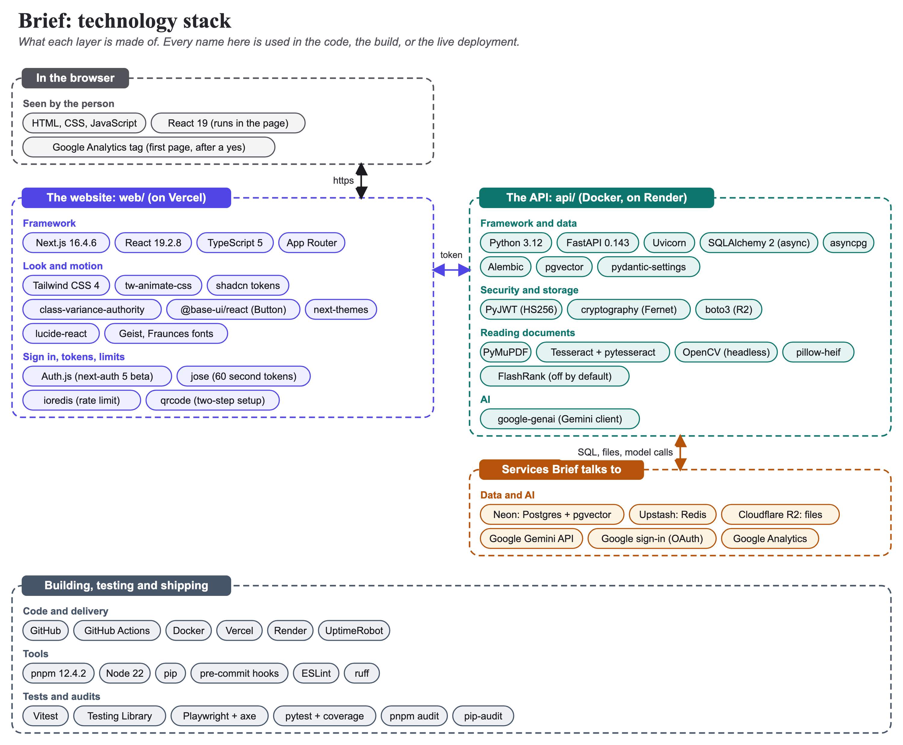

## Architecture

The website is a Next.js app that handles Google sign-in and acts as a thin backend for the browser. It never touches the database or storage. For each request it checks the session, applies a per-user rate limit through Redis, mints a token that expires after 60 seconds, and calls the FastAPI service, which owns everything else: storage, reading documents, splitting them into clauses, search, answers and key terms.

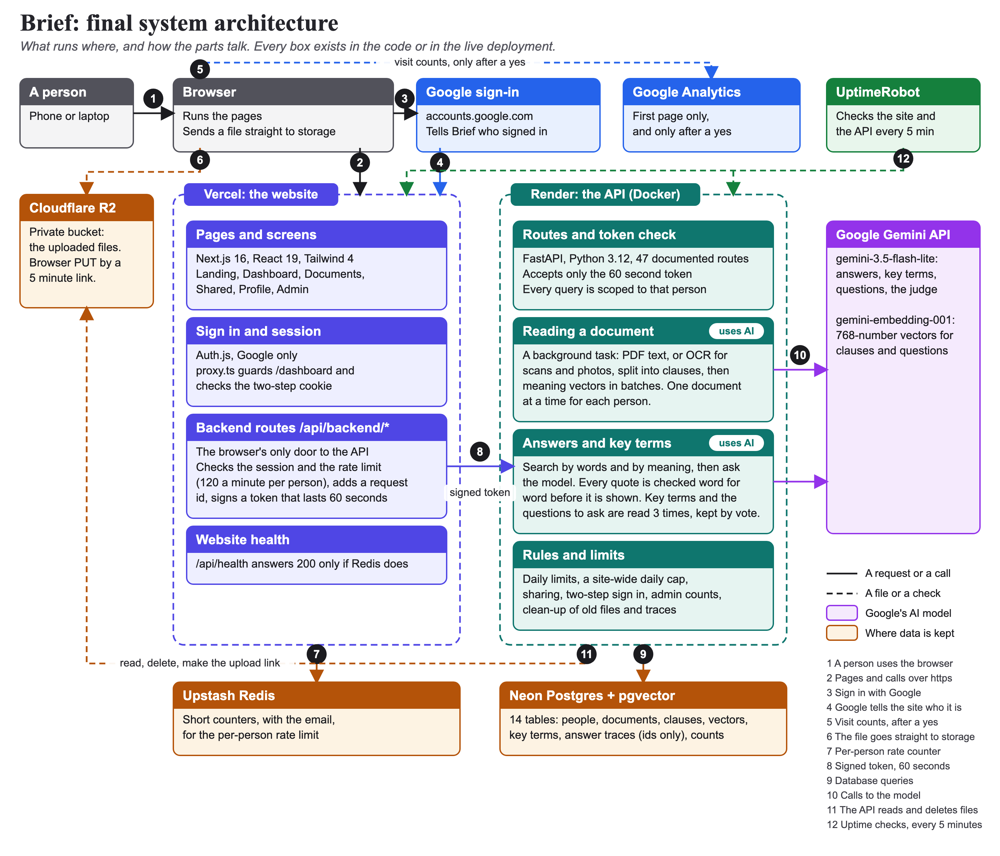

- **Frontend.** App Router pages under `web/app`, components under `web/components`, helpers under `web/lib`. The browser only ever calls the website's own `/api/backend/*` routes.
- **Backend.** One FastAPI app (`api/app/main.py`) with 49 routes. Reading, clause splitting, retrieval, answering, the quote check, voting, limits and sharing are separate modules.
- **Database.** 14 tables and 21 migrations. Clauses and their embeddings live in Postgres with pgvector, next to the users and documents that own them.

[docs/ARCHITECTURE.md](docs/ARCHITECTURE.md) draws the parts, the data and the path of an upload. [Brief-System-Architecture.pdf](Brief-Resources/06-System-Architecture/Brief-System-Architecture.pdf) and [Brief-Architecture-Explanation.pdf](Brief-Resources/06-System-Architecture/Brief-Architecture-Explanation.pdf) go further.

## AI and LLM integration

Brief calls Gemini in three places, always from the API and never from the browser. Everything around those calls is ordinary code.

| Where | Model | What it does |
|---|---|---|
| Reading a document | `gemini-embedding-001` | Turns each clause into 768 numbers that capture its meaning |
| Asking a question | `gemini-embedding-001`, `gemini-3.5-flash-lite` | Finds the best clauses, then writes one answer with quotes |
| Key terms and questions to ask | `gemini-3.5-flash-lite` | Reads the document three times, then a separate call judges each answer |

How an answer is checked:

1. Your question finds the most relevant clauses, using keyword and meaning-based search together.
2. The model is told to answer from those clauses only, and to quote the passage it relied on.
3. Brief checks that each quote really appears in the clause it names, word for word. A quote that does not is thrown away.
4. If nothing survives, you are told the document does not seem to cover it.

The text of a contract is treated as text to read, never as instructions to follow. Every number in a key term must also appear in its quote. Key terms and questions are each read three times with fixed seeds and kept by vote.

What is not AI: clause splitting, search ranking, the quote check, the number check, the vote, the limits and all storage are plain code. Tesseract is OCR software, not a language model. There is no tool calling, no agent loop and no fine-tuning. [Brief-AI-LLM-Documentation.pdf](Brief-Resources/05-Technology-Stack/Brief-AI-LLM-Documentation.pdf) has the details, and [evals/README.md](evals/README.md) describes the evaluations.

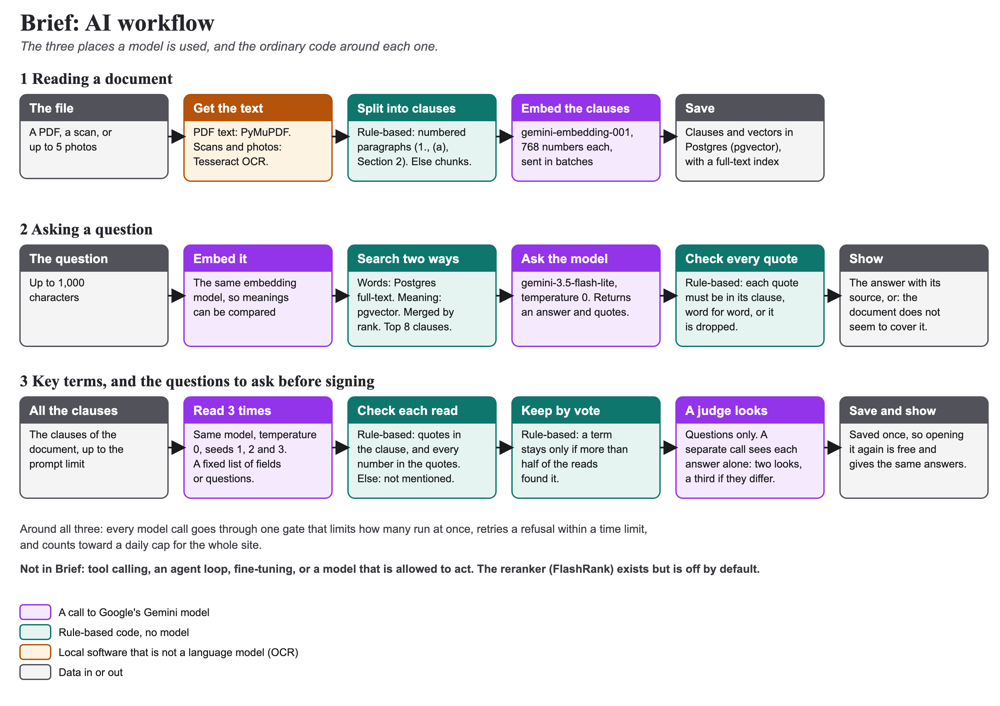

## System design and data flow

1. **Upload.** The browser asks for an upload link, sends the file straight to private storage, then confirms. The API checks the file that really arrived (size and type) before it starts reading.
2. **Read.** Text is extracted (OCR for scans and photos), split into numbered clauses, embedded, and stored with pgvector.
3. **Ask.** The question is embedded, clauses are found by keyword and meaning together, the model answers with quotes, and the quote check decides what is shown.
4. **Overview.** Key terms and questions are built once, read three times and voted, then saved. Opening them again is free.

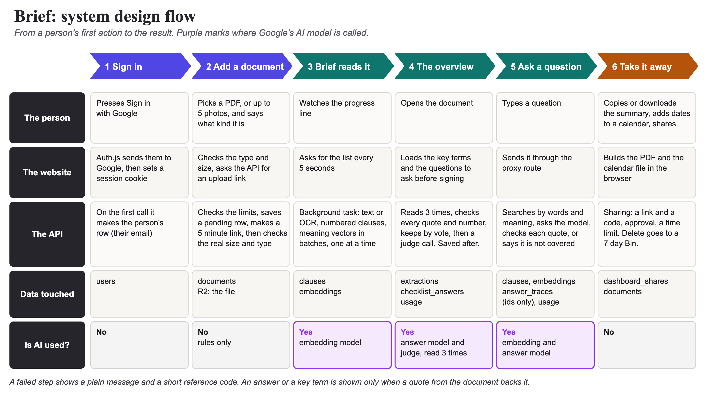

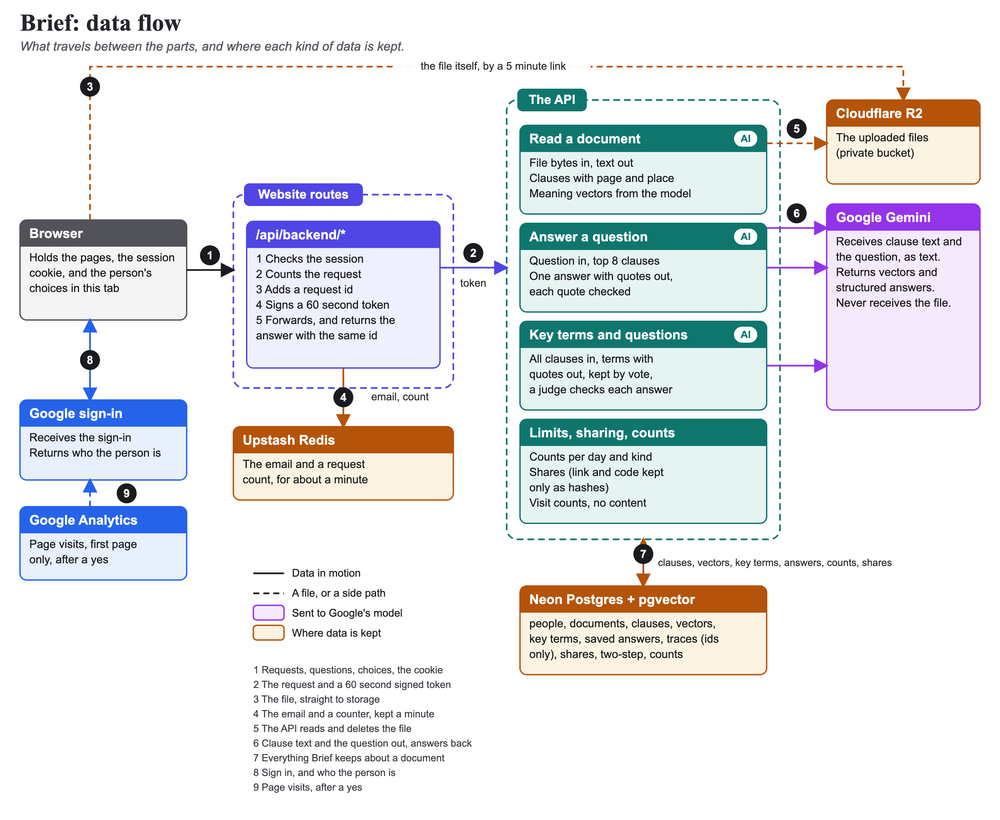

[Brief-System-Design.pdf](Brief-Resources/07-System-Design/Brief-System-Design.pdf) covers requirements, data, security, errors, scale and limits.

## API

Every route except `/health*` needs a signed token from the website. FastAPI's interactive documentation (`/docs`) is served outside production only. The 49 routes, grouped:

| Group | Routes |
|---|---|
| Documents | `GET/POST /documents`, `GET/PATCH/DELETE /documents/{id}`, `/confirm`, `/clauses`, `/file`, `/move`, `/reread`, `/retry`, `/restore`, `DELETE /permanent` |
| Questions and terms | `POST /documents/{id}/ask`, `POST /documents/{id}/search`, `GET /documents/{id}/key-terms`, `GET /documents/{id}/checklist` |
| Bin | `GET /trash` |
| Account | `GET/PATCH/DELETE /me`, `/me/usage`, `/me/insights`, `/me/key-dates`, `/me/activity` |
| Two-step verification | `/me/2fa` with `setup`, `enable`, `verify`, `check`, `disable`, `recovery-codes` |
| Sharing | `/shares` (create, list, join, approve, change access, revoke), `/shared` (list, dashboard, removed) |
| Admin and counters | `GET /admin/stats`, `GET /admin/report`, `POST /events/{name}` |
| Health | `GET/HEAD /health`, `GET /health/db`, `GET/HEAD /health/ready` |

The website adds its own routes under `web/app/api` (`auth`, `backend`, `events`, `health`, `two-factor`).

## CI/CD

Every push and pull request runs three jobs in GitHub Actions ([.github/workflows/ci.yml](.github/workflows/ci.yml)):

| Job | What it runs |
|---|---|
| web, lint, tests and build | `pnpm lint`, `pnpm test:coverage`, `pnpm build` |
| web, browser tests | Playwright on Chromium against a fake API, with traces kept on failure |
| api, lint and tests | `ruff check`, an import check, `alembic upgrade head`, `pytest --cov`, a check of the recorded evaluation scores, and a commit message check |

A separate [dependency audit](.github/workflows/audit.yml) runs on every push and every Monday: `pnpm audit --prod` and `pip-audit`, failing on a known high severity problem. Vercel also builds every pull request as a preview. The release steps and every setting are in [infra/DEPLOY.md](infra/DEPLOY.md), and [Brief-CI-CD-Explanation.pdf](Brief-Resources/08-CI-CD/Brief-CI-CD-Explanation.pdf) explains the pipeline.

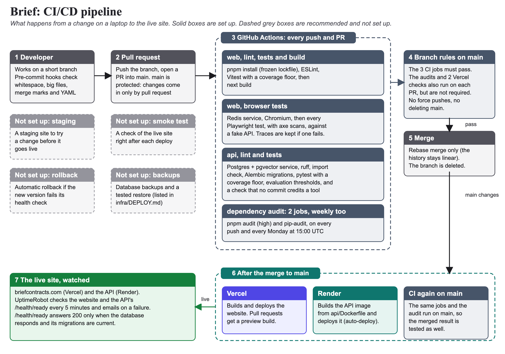

## Run it locally

You need Docker, Python 3.12, Node 22 with pnpm, and Tesseract for photos and scanned pages (`brew install tesseract` on a Mac, `sudo apt-get install tesseract-ocr` on Ubuntu).

```bash
docker compose up -d        # Postgres with pgvector, and Redis
```

**Backend**, from `api/`. Copy `api/.env.example` to `api/.env` and fill in real values (R2, a Gemini key, a JWT secret).

```bash
python3.12 -m venv .venv
source .venv/bin/activate
pip install -r requirements-dev.txt
alembic upgrade head
uvicorn app.main:app --reload
```

**Frontend**, from `web/`. Create `web/.env.local`:

```bash
AUTH_SECRET=         # a long random string, for example from: openssl rand -base64 32
AUTH_GOOGLE_ID=      # Google OAuth client ID
AUTH_GOOGLE_SECRET=  # Google OAuth client secret
SERVICE_JWT_SECRET=  # must match SERVICE_JWT_SECRET in api/.env
BACKEND_URL=http://localhost:8000
REDIS_URL=redis://localhost:6379
```

The Google client needs `http://localhost:3000/api/auth/callback/google` as a redirect address.

```bash
pnpm install
pnpm dev
```

Real sign-in, upload and model calls need real credentials. Without them the unit and browser tests still run, because the browser tests use a fake API. [docs/MANUAL-TEST.md](docs/MANUAL-TEST.md) is a step by step check of the real thing.

## Testing and verified results

```bash
python -m pytest          # from api/, with the venv active and Postgres running
pnpm test                 # from web/, unit tests
pnpm e2e                  # from web/, browser tests
scripts/check-all.sh      # everything CI runs (add --e2e for the browser tests)
```

Measured on November 17, 2026 on a laptop, on the code in this repository (after the demo video change, which added one browser test; the documents in [Brief-Resources](Brief-Resources) quote 3,576, the count of the CI run one pull request earlier):

| Check | Result |
|---|---|
| API tests (pytest) | 1,298 passed, 0 failed |
| Website unit tests (Vitest, 156 files) | 1,937 passed, 0 failed |
| Browser tests (Playwright, Chromium) | 342 passed, 0 failed, 0 skipped |
| **Total test cases** | **3,577** (1,298 + 1,937 + 342), all passing |
| Website lint (ESLint) and types (tsc) | clean |
| API lint (`ruff check`) | clean |
| Production build (`next build`) | succeeds |

The browser tests run against a fake API that checks tokens the way the real one does, so they show the website behaves correctly given those answers, not that the real API is correct. They include accessibility scans and phone-width checks. [web/README.md](web/README.md) explains how to run and watch them. The evaluations call the real Gemini API and need a key; their recorded scores and caveats are in [STATUS.md](STATUS.md).

## Project structure

```text
Brief/
├── api/                    FastAPI service
│   ├── app/                routes, reading, retrieval, answering, checks, limits, sharing
│   ├── migrations/         21 Alembic migrations
│   └── tests/              pytest suite
├── web/                    Next.js website
│   ├── app/                pages and the website's own API routes
│   ├── components/         interface components
│   ├── lib/                helpers
│   ├── e2e/                Playwright browser tests and the fake API
│   └── public/demo/        the demo video, poster and captions
├── evals/                  evaluations that call the real model
├── docs/                   architecture, demo, privacy review, manual test, inventory
├── docs-source/            sources that build the PDFs and diagrams in Brief-Resources
├── Brief-Resources/        screenshots, PDFs and diagrams (see Documentation)
├── infra/                  deployment checklist
├── scripts/                check-all, commit message check, hook installer
└── .github/workflows/      CI and dependency audit
```

## Technical challenges and engineering decisions

- **Fluent but unprovable answers.** Decision: the model must quote, and code checks the quote word for word against the clause. A quote that fails is dropped, and if none survive Brief says the document does not cover it.
- **The same contract read twice can differ.** Decision: key terms and questions are read three times with fixed seeds and kept by vote. On three real leases the voted terms changed 0, 0 and 2 fields between runs, against 4, 5 and 5 for one unseeded read. Steadier is not the same as more accurate, and the longest lease still moved. Voting costs time: a document makes ten or more model calls.
- **Search quality.** Keyword search alone found the right clause first 4 percent of the time on the recorded 24 question test, so search combines keyword and meaning-based matching (96 percent). A reranking step scored worse (67 percent), so it is switched off by default. The test set is small and has no exact-term questions.
- **Near-miss questions.** Evaluation found that a question asking for one specific detail could be answered with the nearest related fact. The answering instruction now treats a related fact that lacks the requested detail as not covered. That is one run on each document, so it is evidence, not proof.
- **Private documents.** The browser never calls the API, tokens expire after 60 seconds, uploads are checked against what the file really is, logs never carry document text (a test reads every logging call), and the servers refuse weak secrets in production.
- **Cost control.** Every read costs a metered call, so there are per-person daily limits (40 questions, 10 reads, 20 overviews) and a site-wide daily cap on model calls as the real spending guard.
- **Hard-to-read photos.** Scans and photos are read by OCR, and ones that are hard to read are flagged instead of quietly accepted.

## Limits, security and privacy

Limits: 50 MB a file, 25 documents a person, 100 pages a document; 40 questions, 10 document reads and 20 overviews a day per person (opening a saved overview is free).

Brief holds private documents, so each layer limits what it can reach: sign-in is checked in the website and again in the API, every request checks ownership, uploads go to private storage with links that expire after five minutes, deleting a document or account removes its files and records, and the owner's admin page shows totals only. A scan of the shipped libraries runs on every push and weekly.

What is not covered, so nobody assumes it is:

- The text of your documents goes to Google's Gemini. Check Google's current terms for how content is handled before you upload something sensitive.
- PDFs from strangers are parsed by a library. Reading them in an isolated process would reduce the risk further.
- There is no audit trail of who opened what, and documents are kept until their owner deletes them.
- The Privacy and Terms pages are plain language I wrote. A lawyer has not reviewed them.
- Brief explains what a document says. It is not legal advice.

## Future improvements

- Confirm the UptimeRobot downtime alert in its account (the repository records it as set up).
- Confirm the per-minute request limit's Redis setting on the live site; the daily limits and the site-wide cap already work.
- Update the development-tool dependencies behind the open alerts (none ship to a user).
- Word (.docx) files, several files in one upload, and sharper handling of low quality photos.
- Larger and messier evaluation sets, including exact-term questions.
- Isolated PDF parsing and an audit trail.

## Documentation

| Document | Read it for |
|---|---|
| [Project Overview](Brief-Resources/01-Project-Overview/Brief-Project-Overview.pdf), [Summary](Brief-Resources/01-Project-Overview/Brief-Project-Summary.pdf), [Key Features](Brief-Resources/01-Project-Overview/Brief-Key-Features.pdf) | What Brief is, the verified results, and every feature with its files |
| [Technology Stack](Brief-Resources/05-Technology-Stack/Brief-Technology-Stack.pdf) | Every technology: what, why, where and how |
| [System Architecture](Brief-Resources/06-System-Architecture/Brief-System-Architecture.pdf), [Explanation](Brief-Resources/06-System-Architecture/Brief-Architecture-Explanation.pdf) | The parts, how they talk, and the journey of a request |
| [System Design](Brief-Resources/07-System-Design/Brief-System-Design.pdf) | Requirements, design, data, security, errors, scale, limits |
| [AI and LLM](Brief-Resources/05-Technology-Stack/Brief-AI-LLM-Documentation.pdf) | Where a model is used, how, and what is checked |
| [CI/CD](Brief-Resources/08-CI-CD/Brief-CI-CD-Explanation.pdf) | How a change reaches the live site |
| [docs/DEMO.md](docs/DEMO.md), [STATUS.md](STATUS.md), [SECURITY.md](SECURITY.md), [CONTRIBUTING.md](CONTRIBUTING.md) | The video, the honest status, reporting a problem, how changes go in |

The sources of the documents and diagrams are in `docs-source/`, and `node build.mjs` there rebuilds them. Changes go in through short branches and pull requests; after cloning, run `scripts/install-hooks.sh` once to install the commit hook.

## Contributors and license

Built by [Shreyas Revankar](https://github.com/iamshrey10). Released under the [MIT License](LICENSE).
