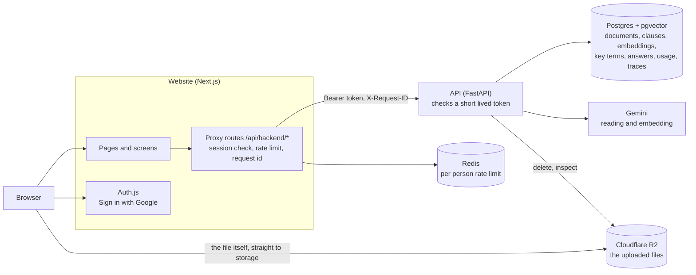
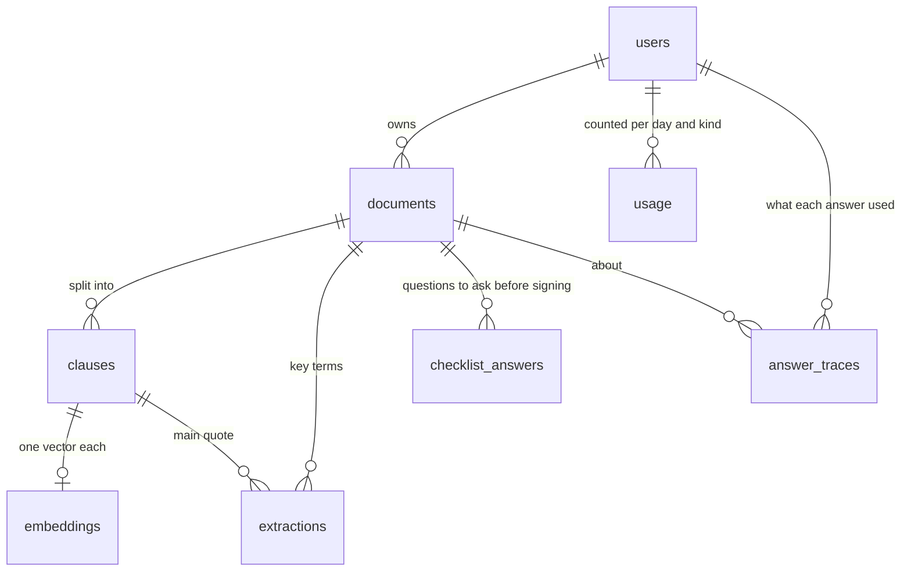
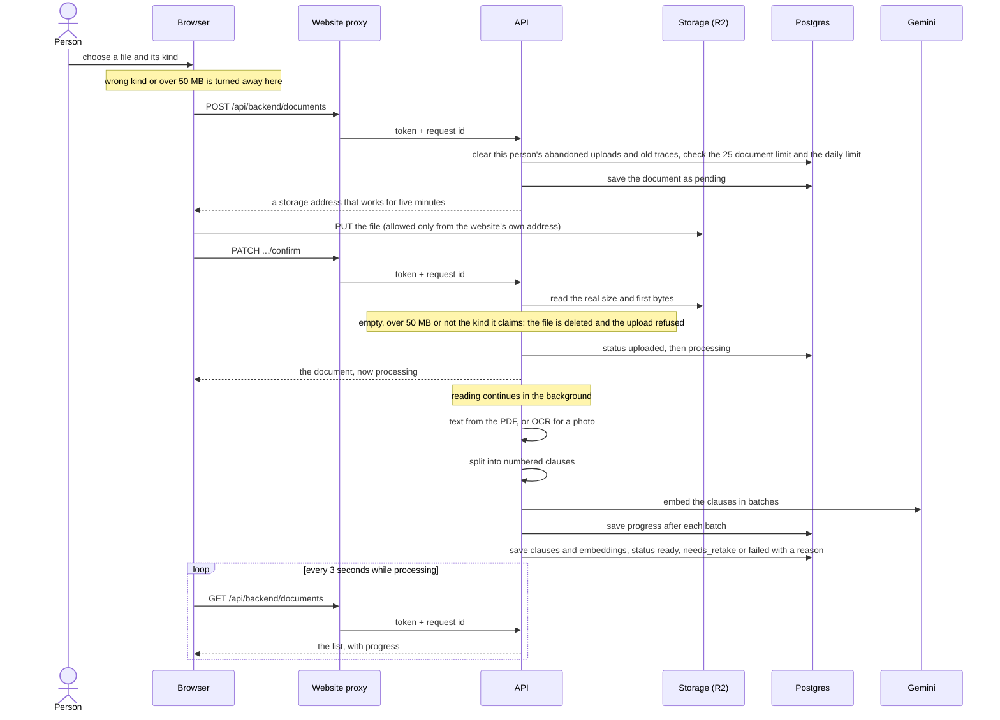
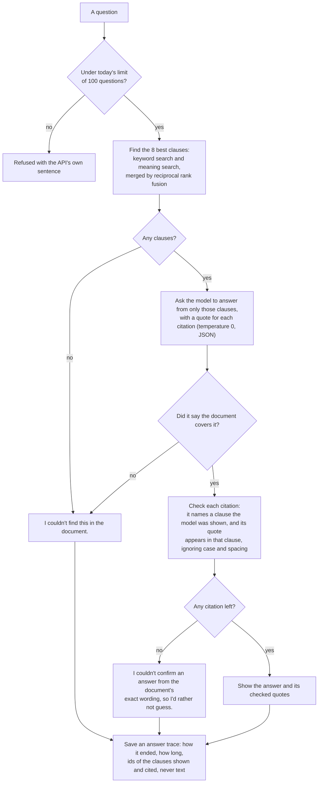
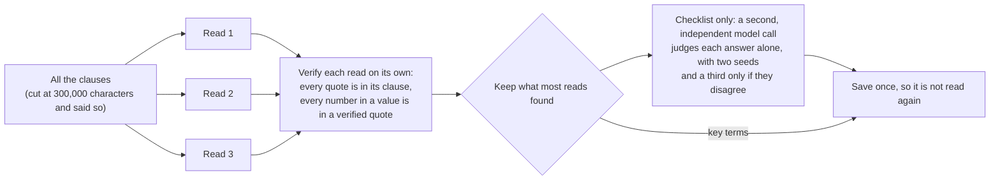

# How Brief is put together

A map of the parts, where each piece of data lives, and the rules that hold it together. The diagrams are written in
Mermaid, which GitHub draws in place. Each claim here is backed by code and, where it matters, by a test, and the
files are named so it can be checked.

## The parts

- **The browser never talks to the API.** Every call goes through the website's proxy routes (`web/lib/proxy.ts`),
  which check the session, apply a rate limit of 30 calls a minute per person in Redis, give the call a request id, and
  sign a token that expires in 60 seconds. A test fails if a route skips the proxy.
- **The API trusts only that token.** It checks the signature, the algorithm (HS256 only) and the expiry, and every
  query is scoped to the person it names, so one person's documents are never reachable by another.
- **Files go straight to storage.** The browser sends the file to a short lived address the API made (five minutes),
  so file bytes never pass through the API. The bucket allows that only from the website's own address
  (`api/app/bucket_cors.py`).
- **The model is only ever shown text to read.** Contract text is treated as data and never as instructions.

## Where the data lives

| Table | What a row is | Goes when |
|---|---|---|
| `users` | one signed in person | they delete their account |
| `documents` | an upload, with a status: `pending`, `uploaded`, `processing`, `ready`, `needs_retake` or `failed` | the person deletes it |
| `clauses` | one numbered clause of a document, with its page and text | its document goes |
| `embeddings` | the meaning-based vector of a clause (768 numbers) | its clause goes |
| `extractions` | one key term of a document, with up to three checked quotes (JSON) | the document is read again or its kind changes |
| `checklist_answers` | one must-ask question of a document, answered with checked quotes or marked a gap | the same |
| `usage` | how many times a person did one kind of model backed thing on one day (UTC) | the account goes |
| `answer_traces` | how one question was answered: how it ended, how long, and the ids of the clauses shown and cited, never text | 30 days, or with its document or account |

Deleting a document removes the stored file first and then its rows, one document at a time, and the account last, so a
failure part way leaves something that can be tried again (`api/app/main.py`).

## From a file to a document that can be asked about

What each step guards against:

| Step | Guard |
|---|---|
| Starting the upload | A name that is too long or tries to climb folders, a kind that does not exist, too many documents, the daily limit. Nothing is read until the upload is confirmed. |
| The file's real nature | The size and first bytes are read from storage, not taken from what the browser said, so a text file renamed `.pdf` is refused and its file deleted. A repeat confirm is refused. |
| Abandoned uploads | One started and never confirmed is removed after an hour when its owner starts the next, so it cannot fill their document limit. |
| Reading | A document over 100 pages, with no text, or password protected ends as `failed` with a plain reason, and the person can try again. A blurry scan ends as `needs_retake` and is still usable. |
| The free tier | Embedding waits out Gemini's per minute limit and reports progress, so a long document shows "Reading part N of M" and never freezes the server. |

## How an answer is reached, and when it is held back

Three things are worth saying about this:

- **The model's output is never taken on trust.** A quote that is not in its clause is thrown away, and an answer with
  no surviving quote is replaced by an honest refusal. The rule is "fail closed": when it cannot be proved, nothing is
  shown.
- **The instruction also says to answer the question that was asked.** If the clauses give only a related fact and
  not the detail requested, the document does not cover it. This was added after two near miss questions in the
  evaluations were answered with the nearest fact (`evals/results/qa-offer-2026-10-22.md`).
- **Every outcome leaves a trace.** A person who sees a failure is shown a short `Reference` code, the first eight
  characters of the request id, and `python -m scripts.find_request <code>` prints what that answer used.

### Key terms and the questions to ask before signing

These read the whole document, not eight clauses, because they have to notice what is missing as well as what is there.

A key term may rest on up to three checked quotes, because a fact such as a deposit can be split across two sentences, and
a question is flagged as a gap when an important question is not answered. Each read uses a fixed seed (1, 2 and 3),
which makes the result steadier. Steadier is not the same as more accurate: the evaluations measure both separately
(`evals/README.md`), and `STATUS.md` says which numbers rest on small tests.
