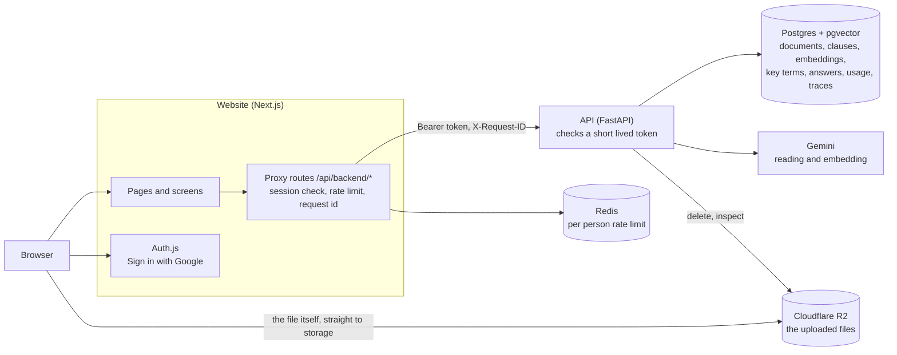
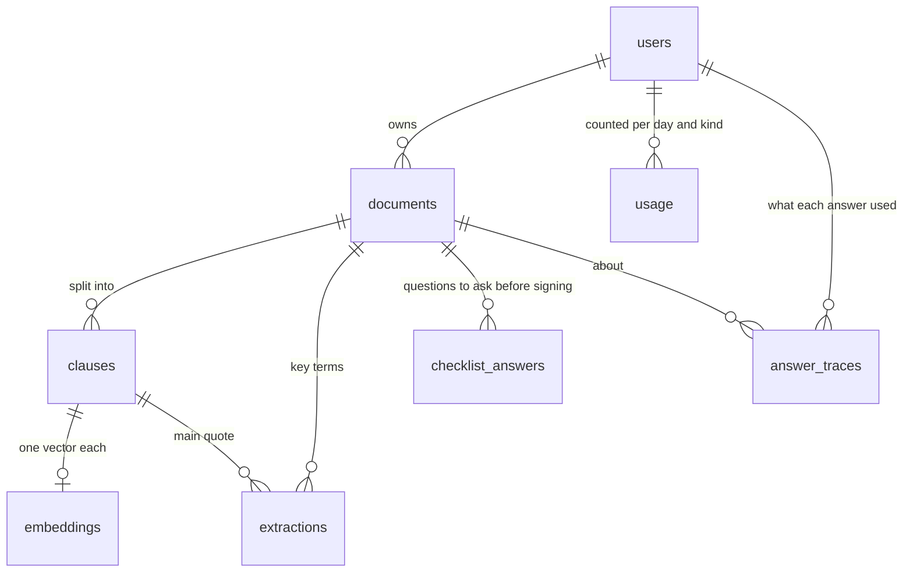

# How Brief is put together

A map of the parts, where each piece of data lives, and the rules that hold it together. The diagrams are written in
Mermaid, which GitHub draws in place. Each claim here is backed by code and, where it matters, by a test, and the
files are named so it can be checked.

## The parts

- **The browser never talks to the API.** Every call goes through the website's proxy routes (`web/lib/proxy.ts`),
  which check the session, apply a rate limit of 30 calls a minute per person in Redis, give the call a request id, and
  sign a token that expires in 60 seconds. A test fails if a route skips the proxy.
- **The API trusts only that token.** It checks the signature, the algorithm (HS256 only) and the expiry, and every
  query is scoped to the person it names, so one person's documents are never reachable by another.
- **Files go straight to storage.** The browser sends the file to a short lived address the API made (five minutes),
  so file bytes never pass through the API. The bucket allows that only from the website's own address
  (`api/app/bucket_cors.py`).
- **The model is only ever shown text to read.** Contract text is treated as data and never as instructions.

## Where the data lives

| Table | What a row is | Goes when |
|---|---|---|
| `users` | one signed in person | they delete their account |
| `documents` | an upload, with a status: `pending`, `uploaded`, `processing`, `ready`, `needs_retake` or `failed` | the person deletes it |
| `clauses` | one numbered clause of a document, with its page and text | its document goes |
| `embeddings` | the meaning-based vector of a clause (768 numbers) | its clause goes |
| `extractions` | one key term of a document, with up to three checked quotes (JSON) | the document is read again or its kind changes |
| `checklist_answers` | one must-ask question of a document, answered with checked quotes or marked a gap | the same |
| `usage` | how many times a person did one kind of model backed thing on one day (UTC) | the account goes |
| `answer_traces` | how one question was answered: how it ended, how long, and the ids of the clauses shown and cited, never text | 30 days, or with its document or account |

Deleting a document removes the stored file first and then its rows, one document at a time, and the account last, so a
failure part way leaves something that can be tried again (`api/app/main.py`).
